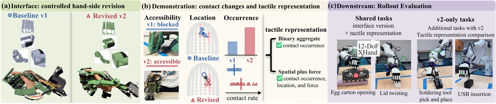

<!-- Generated by scripts/generate.py; edit data/works.json and data/media.json. -->

[← Back to the Awesome index](../../../README.md) · [Interactive website](https://chang-xinhai.github.io/Awesome-RGBDT-Manipulation/?collection=policy&item=wearable-contact-shifts#library)

# Wearable Contact Shifts

From Wearable Interfaces to Dexterous Policies: Contact Shifts and Tactile Representations

**2026-10-06 · Preprint · University of Florida**

**[Paper](https://arxiv.org/abs/2610.08870)**

A controlled study of wearable geometry and tactile representations trains dexterous policies from direct human interaction.

*From Wearable Interfaces to Dexterous Policies: Contact Shifts and Tactile Representations authors · [Figure source](https://arxiv.org/abs/2610.08870) · Original rights retained.*

| Field | Reported value and source scope |
| :-- | :-- |
| Record type | policy |
| Policy family | Diffusion [1](https://arxiv.org/abs/2610.08870)  |
| Base model and architecture | Dex UMI configuration:DINO image encoder and temporal U-Net diffusion policy. [1](https://arxiv.org/abs/2610.08870)  |
| Model size and component | Not reported [1](https://arxiv.org/abs/2610.08870)  |
| Deployment inputs | One wrist RGB image and tactile vector; no proprioception input. [1](https://arxiv.org/abs/2610.08870)  |
| Action outputs and horizon | 16 future wrist pose/12 hand motor command actions. [1](https://arxiv.org/abs/2610.08870)  |
| Training method | 400 epoch behavior cloning; cross interface×binary/spatial-plus-force conditioning. [1](https://arxiv.org/abs/2610.08870)  |
| Training data | Shared lid-twisting/egg-carton cohorts; revised-interface precision tasks 311 soldering tool and 319 USB demos are separate cohorts. [1](https://arxiv.org/abs/2610.08870)  |
| Training duration | 400 epochs; wall-clock Not reported. [1](https://arxiv.org/abs/2610.08870)  |
| Training hardware | Not reported [1](https://arxiv.org/abs/2610.08870)  |
| Inference and control rates | Not reported [1](https://arxiv.org/abs/2610.08870)  |
| Evaluation scope | Real XHand task rollouts and session-level contact shift analysis. [1](https://arxiv.org/abs/2610.08870)  |
| Observations / modalities | RGB · Tactile |
| Evaluation domain | Real world |
| Embodiment | Dexterous hand |
| Release: code | Not verified |
| Release: weights | Not verified |
| Release: data | Not verified |
| Release: license | Not verified |
| Release: notes | Original paper reviewed; claimed future releases are not treated as currently available. |

**Scope and qualifications**

- Richer input changes both spatial structure and force; the experiment does not isolate which component causes gains.
- One policy instance/condition; rollout variation does not quantify training seed variance.

**Primary evidence**

1. [Original paper and supplementary implementation details](https://arxiv.org/abs/2610.08870) — Primary full text reviewed; dataset, deployment modalities and training-only privileges are scoped separately.
