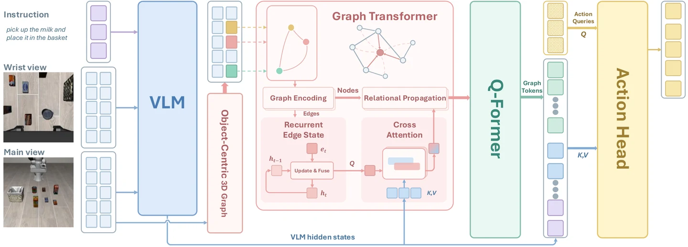

<!-- Generated by scripts/generate.py; edit data/works.json and data/media.json. -->

[← Back to the Awesome index](../../../README.md) · [Interactive website](https://chang-xinhai.github.io/Awesome-RGBDT-Manipulation/?collection=policy&item=weavevla#library)

# WeaveVLA

WeaveVLA: 3D Relational Grounding for Vision-Language-Action Models

**2026-11-23 · Preprint · Hong Kong University of Science and Technology and collaborators**

**[Paper](https://arxiv.org/abs/2611.31126)** · [Project](https://kingzein.github.io/weave-vla/) · [Code](https://github.com/Kingzein/WeaveVLA) · [Weights](https://huggingface.co/Kensag/WeaveVLA)

Builds a task-conditioned recurrent 3D relation graph from RGB and inferred metric depth to guide a VLA action expert.

*Zien Wang and coauthors · [Figure source](https://arxiv.org/html/2611.31126v2) · Original rights retained.*

| Field | Reported value and source scope |
| :-- | :-- |
| Record type | policy |
| Policy family | WeaveVLA [1](https://arxiv.org/html/2611.31126v2)  |
| Base model and architecture | StarVLA-GR00T or π0.5; YOLOE-style mask/detection front end and DA3Metric-Large geometry. [1](https://arxiv.org/html/2611.31126v2)  |
| Model size and component | Not reported [1](https://arxiv.org/html/2611.31126v2)  |
| Deployment inputs | Backbone RGB and robot state, instructions and online geometric relations computed from a third-person RGB view using DA3Metric-Large. The gripper TCP is calibrated from robot kinematics. [1](https://arxiv.org/html/2611.31126v2)  |
| Action outputs and horizon | Low-level commands from either the StarVLA–GR00T or π0.5 action expert conditioned on recurrent graph tokens. [1](https://arxiv.org/html/2611.31126v2)  |
| Training method | Learn sparse relative spatial relations with recurrent edge states and auxiliary geometry reconstruction. [1](https://arxiv.org/html/2611.31126v2)  |
| Training data | LIBERO/CALVIN training and collection-specific cached geometry/detection assets; simulation instance labels support detection training. [1](https://arxiv.org/html/2611.31126v2)  |
| Training duration | Not reported [1](https://arxiv.org/html/2611.31126v2)  |
| Training hardware | Not reported [1](https://arxiv.org/html/2611.31126v2)  |
| Inference and control rates | Not reported [1](https://arxiv.org/html/2611.31126v2)  |
| Evaluation scope | LIBERO and LIBERO-Plus across 10,030 perturbed instances, CALVIN scene D transfer, plus separate four-RGB-view physical tasks. [1](https://arxiv.org/html/2611.31126v2)  |
| Observations / modalities | RGB · Language · Proprioception |
| Evaluation domain | Simulation · Real world |
| Embodiment | Bimanual · Parallel-jaw gripper |
| Release: code | Available — training/evaluation and bundled variants [3](https://github.com/Kingzein/WeaveVLA#readme)  |
| Release: weights | Available — LIBERO policy and detector weights [3](https://github.com/Kingzein/WeaveVLA#readme) [4](https://huggingface.co/Kensag/WeaveVLA/tree/main)  |
| Release: data | Not verified as a standalone dataset [3](https://github.com/Kingzein/WeaveVLA#readme)  |
| Release: license | Bundled StarVLA/OpenPI/Gemma and YOLOE terms apply; no root license independently verified. [3](https://github.com/Kingzein/WeaveVLA#readme)  |
| Release: notes | Public paper verified. Code, task weights and data are tracked separately. [3](https://github.com/Kingzein/WeaveVLA#readme)  |

**Scope and qualifications**

- Metric depths are inferred from RGB at runtime. Geometry use is explicit, but physical sensor depth is not a declared input.

**Primary evidence**

1. [Original author paper with methods, evaluation and scope](https://arxiv.org/html/2611.31126v2)
2. [Public author project with method and evaluation examples](https://kingzein.github.io/weave-vla/)
3. [Author training, settings and checkpoint table](https://github.com/Kingzein/WeaveVLA#readme)
4. [Separate action model and detector weights](https://huggingface.co/Kensag/WeaveVLA/tree/main)
