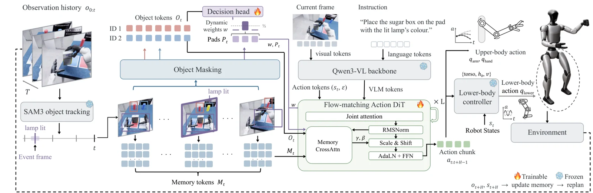

<!-- Generated by scripts/generate.py; edit data/works.json and data/media.json. -->

[← Back to the Awesome index](../../../README.md) · [Interactive website](https://chang-xinhai.github.io/Awesome-RGBDT-Manipulation/?collection=policy&item=wholebodymem#library)

# WholeBodyMem

Memory before Goal: Role of Pre-History Memory for Humanoid Loco-Manipulation

**2026-10-22 · Preprint · Mohamed bin Zayed University of Artificial Intelligence**

**[Paper](https://arxiv.org/abs/2610.31166)** · [Project](https://memory-before-goal.github.io)

Object-event memory preserves pre-goal cues for a whole-body humanoid VLA after the cue leaves the camera view.

*WholeBodyMem authors · [Figure source](https://arxiv.org/abs/2610.31166) · Original rights retained.*

| Field | Reported value and source scope |
| :-- | :-- |
| Record type | policy |
| Policy family | Diffusion [1](https://arxiv.org/abs/2610.31166)  |
| Base model and architecture | Ψ0 whole-body VLA, SAM3 tracking; AMO/SONIC lower-body controllers are setup-specific. [1](https://arxiv.org/abs/2610.31166)  |
| Model size and component | Not reported [1](https://arxiv.org/abs/2610.31166)  |
| Deployment inputs | Head RGB, robot state, object/event-selected historical images and instruction. [1](https://arxiv.org/abs/2610.31166)  |
| Action outputs and horizon | Simulation 36-D whole-body actions; real SONIC motion token plus 14 hand targets. [1](https://arxiv.org/abs/2610.31166)  |
| Training method | Imitation learning on memory-task demonstrations with object-guided memory and decision supervision. [1](https://arxiv.org/abs/2610.31166)  |
| Training data | 90 real demonstrations, 15/task, whole-body PICO teleoperation; simulated demonstrations are scripted. [1](https://arxiv.org/abs/2610.31166)  |
| Training duration | Not reported [1](https://arxiv.org/abs/2610.31166)  |
| Training hardware | One RTX5090 for real policy inference; training hardware not reported. [1](https://arxiv.org/abs/2610.31166)  |
| Inference and control rates | Real SONIC execution50 Hz; 24 of30 predicted actions/chunk; SAM3 about 1.25 Hz. [1](https://arxiv.org/abs/2610.31166)  |
| Evaluation scope | Six memory tasks: 72.6% sim versus 29.1% base; six real G1 tasks: 53/60 =88.3% versus 22/60 =36.7%. Standard 14 SIMPLE tasks remain separate. [1](https://arxiv.org/abs/2610.31166)  |
| Observations / modalities | RGB · Proprioception · Language |
| Evaluation domain | Simulation · Real world |
| Embodiment | Humanoid · Dexterous hand |
| Release: code | Not released [2](https://memory-before-goal.github.io)  |
| Release: weights | Not verified [2](https://memory-before-goal.github.io)  |
| Release: data | Not verified [2](https://memory-before-goal.github.io)  |
| Release: license | Not verified [2](https://memory-before-goal.github.io)  |
| Release: notes | Current official project still identifies itself as an anonymous draft with unreleased artifacts; primary paper supplies authors and final evaluated numbers. No method implementation/checkpoints established. [2](https://memory-before-goal.github.io)  |

**Scope and qualifications**

- RealSense hardware does not by itself establish that depth is fed to the policy.
- Memory-task results, standard SIMPLE tasks and real tasks have different episode budgets.
- Project contains draft/TBD labels; manuscript evidence takes precedence for reported results.

**Primary evidence**

1. [Primary manuscript and first-submission history](https://arxiv.org/abs/2610.31166) — Current primary manuscript reviewed; first-public date uses arXiv v1. Observations, training privileges and deployed interfaces retain their separate scopes.
2. [Official project source and actual artifact inventory](https://memory-before-goal.github.io) — Reviewed 26 October 2026. Availability and licensing apply only to the described released component, independently of paper results.
