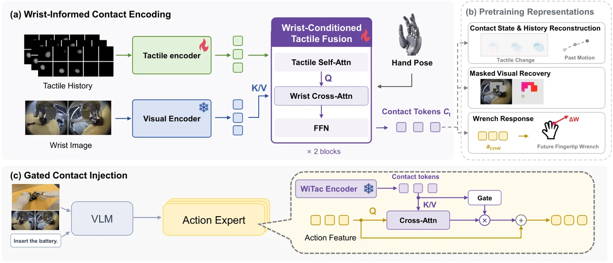

<!-- Generated by scripts/generate.py; edit data/works.json and data/media.json. -->

[← Back to the Awesome index](../../../README.md) · [Interactive website](https://chang-xinhai.github.io/Awesome-RGBDT-Manipulation/?collection=policy&item=witac#library)

# WiTac

WiTac: Wrist-Informed Tactile Representations for Contact-Rich Manipulation

**2026-11-16 · Preprint · Sharpa Robotics and collaborators**

**[Paper](https://arxiv.org/abs/2611.21057)** · [Project](https://wrist-informed-tactile-representations.github.io/) · [Data](https://huggingface.co/datasets/Sharpa-Robotics/SharpaDex-v1.0) · [Base-Encoder](https://huggingface.co/Sharpa-Robotics/sharpawave-deform-encoder)

Fuses wrist-view features and causal fingertip deformation histories into finger-level contact tokens before VLA conditioning.

*WiTac authors · [Figure source](https://arxiv.org/html/2611.21057v2) · Original rights retained.*

| Field | Reported value and source scope |
| :-- | :-- |
| Record type | model |
| Model role and downstream interface | Contact representation for policy conditioning [1](https://arxiv.org/html/2611.21057)  |
| Model family | Causal visuo-tactile encoder [1](https://arxiv.org/html/2611.21057)  |
| Model architecture | SharpaWave Deform Encoder and frozen DINOv3 [1](https://arxiv.org/html/2611.21057)  |
| Model size and component | Not reported [1](https://arxiv.org/html/2611.21057)  |
| Model inputs | Wrist RGB, finger deformation history and fingertip/hand kinematics. [1](https://arxiv.org/html/2611.21057)  |
| Model outputs | Ten fingertip contact tokens for downstream gated cross-attention. [1](https://arxiv.org/html/2611.21057)  |
| Training method | Self-supervised contact reconstruction, masked visual recovery and action-conditioned wrench change prediction. [1](https://arxiv.org/html/2611.21057)  |
| Training data and scale | Nearly 300 hours of SharpaDex v1.0; paper’s own downstream task demonstrations are separate. [1](https://arxiv.org/html/2611.21057)  |
| Training duration | Not reported [1](https://arxiv.org/html/2611.21057)  |
| Training hardware | Not reported [1](https://arxiv.org/html/2611.21057)  |
| Inference setting and runtime | Freeze WiTac after pretraining. The prediction heads are removed at inference. [1](https://arxiv.org/html/2611.21057)  |
| Downstream evaluation and scope | Conditioning GR00T N1.7 and π0.5 improves mean task success over vision-only on four real Sharpa North tasks. [1](https://arxiv.org/html/2611.21057)  |
| Observations / modalities | RGB · Tactile · Proprioception |
| Evaluation domain | Real world |
| Embodiment | Sharpa North with Sharpa Wave hands |
| Release: code | Not verified [2](https://wrist-informed-tactile-representations.github.io/) [3](https://huggingface.co/datasets/Sharpa-Robotics/SharpaDex-v1.0)  |
| Release: weights | WiTac weights not verified; public upstream SharpaWave Deform Encoder is separate [2](https://wrist-informed-tactile-representations.github.io/) [3](https://huggingface.co/datasets/Sharpa-Robotics/SharpaDex-v1.0)  |
| Release: data | Public upstream SharpaDex v1.0 corpus; WiTac task dataset not verified [2](https://wrist-informed-tactile-representations.github.io/) [3](https://huggingface.co/datasets/Sharpa-Robotics/SharpaDex-v1.0)  |
| Release: license | Not verified [2](https://wrist-informed-tactile-representations.github.io/) [3](https://huggingface.co/datasets/Sharpa-Robotics/SharpaDex-v1.0)  |
| Release: notes | The paper identifies the upstream pretrained encoder and dataset. Their availability does not establish a WiTac model or policy release. [2](https://wrist-informed-tactile-representations.github.io/) [3](https://huggingface.co/datasets/Sharpa-Robotics/SharpaDex-v1.0)  |

**Scope and qualifications**

- Recorded fingertip wrench and future action prefixes supervise pretraining. The downstream encoder uses only available tactile, wrist and robot-state histories.
- Published physical results compare two conditioned VLA backbones on four tasks.

**Primary evidence**

1. [Primary paper and evaluated setting](https://arxiv.org/html/2611.21057)
2. [Author project and artifact status](https://wrist-informed-tactile-representations.github.io/)
3. [Official repository and public artifact inventory](https://huggingface.co/datasets/Sharpa-Robotics/SharpaDex-v1.0) — Upstream pretraining data only.
