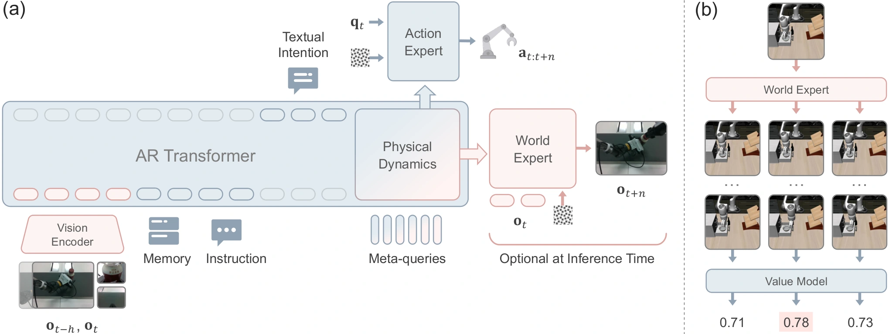

<!-- Generated by scripts/generate.py; edit data/works.json and data/media.json. -->

[← Back to the Awesome index](../../../README.md) · [Interactive website](https://chang-xinhai.github.io/Awesome-RGBDT-Manipulation/?collection=policy&item=wla#library)

# WLA-0 / WLA

World-Language-Action Model for Unified World Modeling, Language Reasoning, and Action Synthesis

**2026-06-04 · CoRL 2026 (official repository) · Shanghai Jiao Tong University / SII**

**[Paper](https://arxiv.org/abs/2606.05979)** · [Project](https://github.com/SJTU-DENG-Lab/WLA) · [Code](https://github.com/SJTU-DENG-Lab/WLA) · [Data](https://huggingface.co/datasets/SJTU-DENG-Lab/RoboTwin-LeRobot) · [Weights](https://huggingface.co/collections/SJTU-DENG-Lab/wla)

Combines autoregressive subtask reasoning, a training-time visual world expert and flow-matching robot actions; optionally ranks candidate actions using imagined states.

*Yang et al. / WLA authors · [Figure source](https://arxiv.org/html/2606.05979v1) · Original rights retained.*

| Field | Reported value and source scope |
| :-- | :-- |
| Record type | policy |
| Policy family | World-action model [1](https://arxiv.org/abs/2606.05979)  |
| Base model and architecture | RynnBrain-2B autoregressive backbone; SANA-600M world expert; flow-matching action expert [1](https://arxiv.org/abs/2606.05979)  |
| Model size and component | 3.4B total; components: 2.1B backbone / 900M world including VAE / 390M action; paper reports ≈ 2B active in efficient mode [1](https://arxiv.org/abs/2606.05979) [3](https://arxiv.org/html/2606.05979v1)  |
| Deployment inputs | Current/history RGB observations, robot state and language; accumulated subtask text in memory-dependent settings [1](https://arxiv.org/abs/2606.05979) [2](https://github.com/SJTU-DENG-Lab/WLA)  |
| Action outputs and horizon | Action chunks: 8 steps LIBERO, 32 elsewhere; optional subtask text and future static frame; released RoboTwin configurations use 16D EE or 14D joint interfaces [1](https://arxiv.org/abs/2606.05979) [2](https://github.com/SJTU-DENG-Lab/WLA)  |
| Training method | Joint intention/world/action learning through meta-queries; disable world expert in efficient mode or enable value-ranked test-time scaling [1](https://arxiv.org/abs/2606.05979)  |
| Training data | RoboTwin: 2,500 clean + 25,000 randomized trajectories; LIBERO 40 tasks × 50 demos; real 60 demos/task [1](https://arxiv.org/abs/2606.05979) [3](https://arxiv.org/html/2606.05979v1)  |
| Training duration | RoboTwin/LIBERO 100k updates; RMBench 30k/task; real 50k; wall-clock not reported [1](https://arxiv.org/abs/2606.05979) [3](https://arxiv.org/html/2606.05979v1)  |
| Training hardware | Training accelerator model not reported; released train.sh launches 8 processes; inference RTX5090 [1](https://arxiv.org/abs/2606.05979) [4](https://raw.githubusercontent.com/SJTU-DENG-Lab/WLA/main/train.sh)  |
| Inference and control rates | Efficient-mode inference ≈ 40 ms on RTX5090; synchronous execution; command/servo rate not reported [1](https://arxiv.org/abs/2606.05979) [3](https://arxiv.org/html/2606.05979v1)  |
| Evaluation scope | RoboTwin 2.0, LIBERO, RMBench; real Piper dual-arm robust/dynamic tasks [1](https://arxiv.org/abs/2606.05979)  |
| Observations / modalities | RGB · Proprioception · Language |
| Evaluation domain | Simulation · Real world |
| Embodiment | Parallel-jaw gripper · Bimanual |
| Release: code | Available [2](https://github.com/SJTU-DENG-Lab/WLA)  |
| Release: weights | Available [2](https://github.com/SJTU-DENG-Lab/WLA)  |
| Release: data | Available [2](https://github.com/SJTU-DENG-Lab/WLA)  |
| Release: license | Apache-2.0 code; model/data terms require individual Hub cards [2](https://github.com/SJTU-DENG-Lab/WLA) [5](https://raw.githubusercontent.com/SJTU-DENG-Lab/WLA/main/LICENSE)  |
| Release: notes | Official code includes training/evaluation scripts and LIBERO/RoboTwin/RMBench checkpoints; no local reproduction performed. [2](https://github.com/SJTU-DENG-Lab/WLA)  |

**Scope and qualifications**

- No embodied pretraining means no extra robot pretraining; RynnBrain/SANA foundation components are pretrained.
- Efficient mode omits visual world prediction; active-parameter count is the manuscript claim rather than a recomputed sum.
- Do not conflate WLA with WorldVLA, T-WLA or WALL-WM.

**Primary evidence**

1. [Primary manuscript and submission history](https://arxiv.org/abs/2606.05979) — Publication date is first arXiv submission; quantitative details retain the reported setting.
2. [Official model repository](https://github.com/SJTU-DENG-Lab/WLA) — Deployment observations, released checkpoint versions and paper claims are checked separately.
3. [Full paper: Section 4.1 and evaluation settings](https://arxiv.org/html/2606.05979v1) — Total and active sizes have different scopes; inference latency is measured on RTX5090.
4. [Official training launcher](https://raw.githubusercontent.com/SJTU-DENG-Lab/WLA/main/train.sh) — Eight launched processes is not evidence of a particular accelerator model.
5. [Code license](https://raw.githubusercontent.com/SJTU-DENG-Lab/WLA/main/LICENSE) — Apache-2.0, code scope only.
