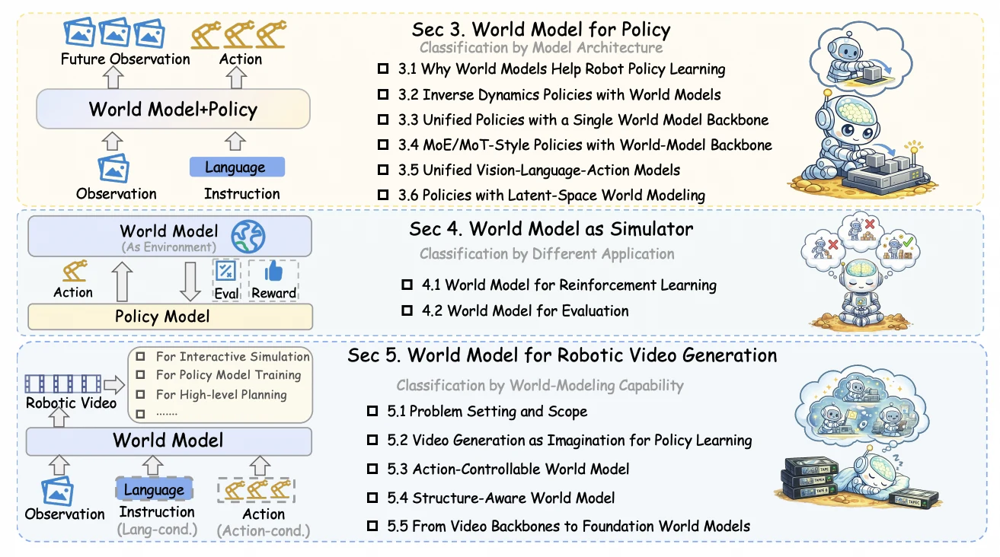

<!-- Generated by scripts/generate.py; edit data/works.json and data/media.json. -->

[← Back to the Awesome index](../../../README.md) · [Interactive website](https://chang-xinhai.github.io/Awesome-RGBDT-Manipulation/?collection=policy&item=wm-robot-learning-survey#library)

# World Models for Robot Learning — Survey

World Model for Robot Learning: A Comprehensive Survey

**2026-04-30 · Preprint · Survey · Nanyang Technological University; UC Berkeley; Stanford; University of Tokyo; Oxford; Microsoft; ETH Zurich; Princeton; Harvard**

**[Paper](https://arxiv.org/abs/2605.00080)** · [Project](https://ntumars.github.io/wm-robot-survey/) · [Code](https://github.com/NTUMARS/Awesome-World-Model-for-Robotics-Policy)

A robot-learning review separates predictive models used inside policies, learned simulators and robotic-video generation.

*Hou et al. / World Model for Robot Learning survey authors · [Figure source](https://ntumars.github.io/wm-robot-survey/) · Original rights retained.*

| Field | Reported value and source scope |
| :-- | :-- |
| Record type | Survey |
| Review scope | Predictive world models for robot learning, with connections to navigation and driving. [1](https://arxiv.org/abs/2605.00080) [2](https://ntumars.github.io/wm-robot-survey/)  |
| Organizing taxonomy | World model for policy · World model as simulator · Robotic video world model [1](https://arxiv.org/abs/2605.00080) [2](https://ntumars.github.io/wm-robot-survey/)  |
| Adaptation mechanisms | Prediction–action coupling; learned-simulator policy improvement/evaluation; controllable or structured video prediction. [1](https://arxiv.org/abs/2605.00080) [2](https://ntumars.github.io/wm-robot-survey/)  |
| Context and evidence | Observations, instructions and action conditioning; geometric and contact structure are distinguished from generic video prediction. [1](https://arxiv.org/abs/2605.00080) [2](https://ntumars.github.io/wm-robot-survey/)  |
| Evaluation dimensions | Predictive fidelity · Action consistency · Downstream task utility · Simulator reliability · Runtime and rollout stability [1](https://arxiv.org/abs/2605.00080) [2](https://ntumars.github.io/wm-robot-survey/)  |
| Literature corpus and snapshot | 43-page author manuscript with six figures; project timeline explicitly ends March 31, 2026, while the live companion list can evolve. [1](https://arxiv.org/abs/2605.00080) [2](https://ntumars.github.io/wm-robot-survey/)  |
| Literature selection | Architectural and functional synthesis with datasets, benchmark tables and an author-maintained bibliography. [1](https://arxiv.org/abs/2605.00080) [2](https://ntumars.github.io/wm-robot-survey/) [3](https://github.com/NTUMARS/Awesome-World-Model-for-Robotics-Policy)  |
| Coverage boundaries | Not a manipulation-only or measured-depth-only inventory. A listed video model is not automatically an executable robot controller; the timeline date is not the review date of every later repository entry. [1](https://arxiv.org/abs/2605.00080) [2](https://ntumars.github.io/wm-robot-survey/)  |
| Review format | Literature review |
| Release: code | Available — maintained literature list, not a new executable policy [2](https://ntumars.github.io/wm-robot-survey/) [3](https://github.com/NTUMARS/Awesome-World-Model-for-Robotics-Policy)  |
| Release: weights | Not applicable — survey |
| Release: data | Not applicable — literature review |
| Release: license | Original article and companion repository retain their respective terms; not independently verified as one shared license. |
| Release: notes | Paper, project taxonomy and bibliography inspected; survey citations discover methods, original sources establish method specifications. |

**Scope and qualifications**

- A learned environment, a policy using one and a policy trained with a prediction objective are separate roles.

**Primary evidence**

1. [Original survey and first manuscript date](https://arxiv.org/abs/2605.00080)
2. [Author taxonomy and timeline](https://ntumars.github.io/wm-robot-survey/)
3. [Author-maintained bibliography](https://github.com/NTUMARS/Awesome-World-Model-for-Robotics-Policy)
