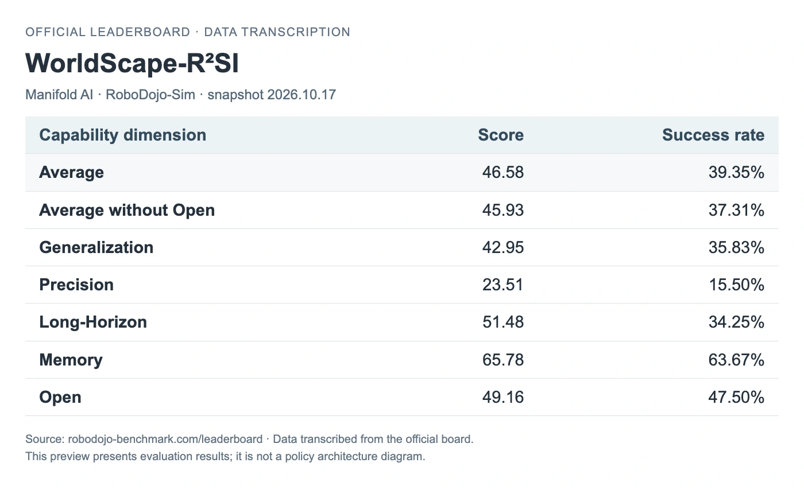

<!-- Generated by scripts/generate.py; edit data/works.json and data/media.json. -->

[← Back to the Awesome index](../../../README.md) · [Interactive website](https://chang-xinhai.github.io/Awesome-RGBDT-Manipulation/?collection=policy&item=worldscape-r2si#library)

# WorldScape R²SI

WorldScape R²SI (Recursive Robot Self-Improvement)

**2026-10-17 · Launch coverage / official leaderboard entry · Manifold AI**

**[Leaderboard](https://robodojo-benchmark.com/leaderboard)** · [Report](https://mp.weixin.qq.com/s/GqI66EPiB9xz7Bz_LxwdmQ)

A launch-reported two-level robot agent that revises reusable skills and can update a reactive WorldScape Policy component. Its identity, contributor and simulation results are confirmed by the official RoboDojo leaderboard; the method description has not been corroborated by a public technical report.

*RoboDojo official leaderboard, snapshot 2026-10-17. Data typography adapted by this catalog. · [Figure source](https://robodojo-benchmark.com/leaderboard) · Original rights retained.*

**Preview scope:** Data transcribed from the official 2026-10-17 leaderboard snapshot. This is an evaluation-source preview, not a policy architecture figure. Score and success rate are separate metrics.

| Field | Reported value and source scope |
| :-- | :-- |
| Record type | policy |
| Policy family | Robot agent [4](https://mp.weixin.qq.com/s/GqI66EPiB9xz7Bz_LxwdmQ)  |
| Base model and architecture | Launch coverage describes inner and outer VLM agents plus an optional reactive WorldScape Policy (WSP) skill. VLM names, reactive checkpoint version and exact base models are not independently verified. [4](https://mp.weixin.qq.com/s/GqI66EPiB9xz7Bz_LxwdmQ)  |
| Model size and component | Not reported for this R²SI system; WorldScape Policy 2.0 component sizes are not inherited. |
| Deployment inputs | Launch coverage reports multi-view RGB, robot state, task descriptions and episode memory. These inputs are not independently verified against an R²SI technical report or release. [4](https://mp.weixin.qq.com/s/GqI66EPiB9xz7Bz_LxwdmQ)  |
| Action outputs and horizon | Launch coverage reports skill/tool execution and optional reactive WSP action chunks that return control to the inner agent. Native action dimensions and interfaces are not independently verified. [4](https://mp.weixin.qq.com/s/GqI66EPiB9xz7Bz_LxwdmQ)  |
| Training method | Launch coverage describes an inner Robot Agent executing task skills and an outer Recursion Agent revising skills, testing versions and optionally training WSP. The complete improvement loop and any meta-level self-modification are not independently verified. [4](https://mp.weixin.qq.com/s/GqI66EPiB9xz7Bz_LxwdmQ)  |
| Training data | Launch coverage reports reuse of rollout records for skill revision and, for WSP-enabled tasks, reactive-model training. Dataset scale and the leaderboard checkpoint’s training corpus are not reported. [4](https://mp.weixin.qq.com/s/GqI66EPiB9xz7Bz_LxwdmQ)  |
| Training duration | Not reported |
| Training hardware | Not reported |
| Inference and control rates | Not reported |
| Evaluation scope | Historical RoboDojo-Sim snapshot 2026-10-17: average Score 46.58 and success rate 39.35%; Precision Score 23.51 and success rate 15.50%. The simulation entry is separate from the real-world leaderboard; this listing does not independently establish the launch article’s recursive-improvement claims. Current official October 24 snapshot: WorldScape-R²SI:Score 46.58, success 39.35%. These live-board results remain separate from the manuscript/development protocols. [1](https://robodojo-benchmark.com/data/leaderboard.generated.json) [5](https://robodojo-benchmark.com/data/leaderboard.generated.json)  |
| Observations / modalities |  |
| Evaluation domain | Simulation |
| Embodiment |  |
| Release: code | Not verified — no R²SI-specific public implementation was located. [2](https://github.com/manifoldai-research/WorldScape-Policy)  |
| Release: weights | Not verified — no R²SI-specific checkpoint release was located. [2](https://github.com/manifoldai-research/WorldScape-Policy) [3](https://huggingface.co/manifoldai-research/WorldScape-Policy-2)  |
| Release: data | Not verified — no R²SI-specific public training or rollout dataset was located. [2](https://github.com/manifoldai-research/WorldScape-Policy)  |
| Release: license | Not verified for R²SI; WorldScape Policy 2.0 code and weight licenses do not establish this system’s release terms. [2](https://github.com/manifoldai-research/WorldScape-Policy) [3](https://huggingface.co/manifoldai-research/WorldScape-Policy-2)  |
| Release: notes | The official WorldScape Policy repository and Hugging Face model release are labeled 2.0. They are related earlier artifacts and are not linked as R²SI releases. [2](https://github.com/manifoldai-research/WorldScape-Policy)  |

**Scope and qualifications**

- The displayed date is the explicit news-publication event (2026-10-17), not a paper submission date; a public R²SI technical report has not been established.
- Technical descriptions are explicitly attributed to launch coverage. The official leaderboard independently confirms the entry, contributor and reported metrics, not the internal architecture or improvement mechanism.
- The launch article also mentions WorldScape Policy 2.5. No separate primary technical report or version-specific release was located; it is not treated as a renamed WorldScape Policy 2.0 checkpoint or a separately verified model here.
- No measured depth or tactile input is established for R²SI. The source illustration labels RGB-only deployment, but primary implementation evidence remains unavailable.
- R²SI is distinct from R²-WAM (arXiv: 2610.04913), a separate repair-and-reject post-training method.

**Primary evidence**

1. [Official RoboDojo-Sim leaderboard — 2026-10-17 snapshot](https://robodojo-benchmark.com/data/leaderboard.generated.json) — The new row names WorldScape-R²SI, contributor Manifold AI, and per-dimension simulation metrics. The row supplies no paper, project, code, data, weights or implementation details. The snapshot date is not treated as a paper submission date.
2. [Author release-scope audit — existing WorldScape Policy 2.0](https://github.com/manifoldai-research/WorldScape-Policy) — Current main README and published webpage branch identify WorldScape Policy 2.0. This is a related-release scope check, not R²SI code or proof that no private implementation exists.
3. [Author weight-release scope — WorldScape Policy 2.0](https://huggingface.co/manifoldai-research/WorldScape-Policy-2) — The public model card/checkpoints are labeled WorldScape Policy 2.0. No R²SI-specific or WorldScape Policy 2.5 checkpoint was established from this reviewed release.
5. [Fresh official scored submission —26October2026](https://robodojo-benchmark.com/data/leaderboard.generated.json) — JSON updateOctober24 and current app system-type map inspected; scores are unchanged from previous aliases where applicable. Input modalities and actual release scope were rechecked from the original system.

**Attributed launch coverage (secondary)**

4. [Launch coverage — 机器之心, 2026-10-17 (secondary source)](https://mp.weixin.qq.com/s/GqI66EPiB9xz7Bz_LxwdmQ) — Article read through a normal Chrome browser. This supports only explicitly attributed launch descriptions and the report-publication event. It is not primary technical evidence; no R²SI paper or author technical release was located.
