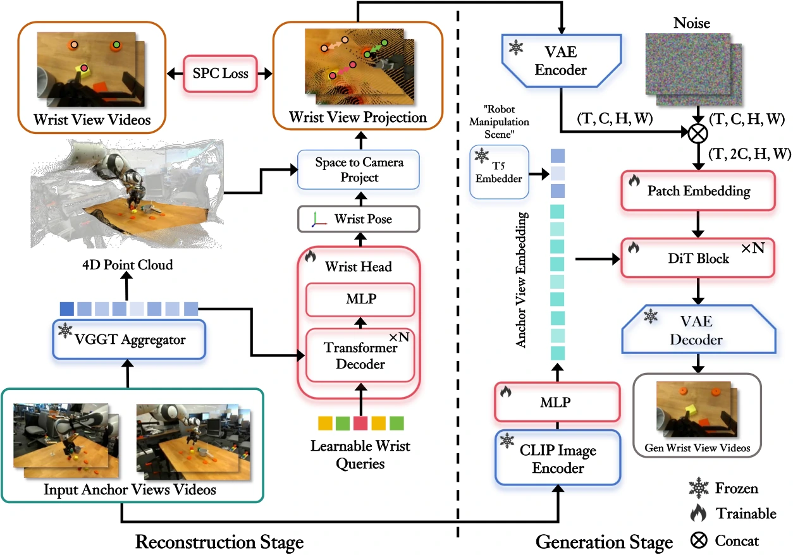

<!-- Generated by scripts/generate.py; edit data/works.json and data/media.json. -->

[← Back to the Awesome index](../../../README.md) · [Interactive website](https://chang-xinhai.github.io/Awesome-RGBDT-Manipulation/?collection=policy&item=wristworld#library)

# WristWorld

WristWorld: Generating Wrist-Views via 4D World Models for Robotic Manipulation

**2025-10-08 · arXiv preprint · Peking University; collaborating institutions as manuscript**

**[Paper](https://arxiv.org/abs/2510.07313)**

Generates missing wrist-camera videos from anchor-camera sequences to augment manipulation-policy training.

*WristWorld authors · [Figure source](https://arxiv.org/html/2510.07313) · Original rights retained.*

| Field | Reported value and source scope |
| :-- | :-- |
| Record type | model |
| Model role and downstream interface | Cross-view generation and policy data augmentation [1](https://arxiv.org/abs/2510.07313)  |
| Model family | Predictive world model [1](https://arxiv.org/abs/2510.07313)  |
| Model architecture | VGGT-based 4D reconstruction with spatial-projection consistency, followed by video synthesis. [1](https://arxiv.org/abs/2510.07313)  |
| Model size and component | Not reported in the inspected primary-source sections [1](https://arxiv.org/abs/2510.07313)  |
| Model inputs | Anchor-view RGB sequences and specified wrist-view geometry; no observed wrist first frame required. [1](https://arxiv.org/abs/2510.07313)  |
| Model outputs | Synthesized wrist-view videos and intermediate geometry/poses. [1](https://arxiv.org/abs/2510.07313)  |
| Training method | Reconstruction/generation learning; generated views used as downstream VLA training augmentation. [1](https://arxiv.org/abs/2510.07313)  |
| Training data and scale | DROID and CALVIN anchor/wrist video data; task-specific downstream policy demonstrations. [1](https://arxiv.org/abs/2510.07313)  |
| Training duration | Not reported in the inspected primary-source sections [1](https://arxiv.org/abs/2510.07313)  |
| Training hardware | Not reported in the inspected primary-source sections [1](https://arxiv.org/abs/2510.07313)  |
| Inference setting and runtime | Not reported in the inspected primary-source sections [1](https://arxiv.org/abs/2510.07313)  |
| Downstream evaluation and scope | Video quality/spatial consistency and downstream CALVIN/Franka policy comparisons. [1](https://arxiv.org/abs/2510.07313)  |
| Observations / modalities | RGB |
| Evaluation domain | Simulation · Real world |
| Embodiment |  |
| Release: code | Not verified |
| Release: weights | Not verified |
| Release: data | Not verified |
| Release: license | Not verified |
| Release: notes | Code, data and weights are checked independently; an upstream pretrained model is not a released task policy. |

**Scope and qualifications**

- WristWorld is a data/view generator; its output is not a tactile observation or independently executable policy.

**Primary evidence**

1. [Original manuscript and first submission history](https://arxiv.org/abs/2510.07313) — Full author HTML method/evaluation/appendix inspected; depth observations, pseudo-labels and generated outputs retain distinct roles.
