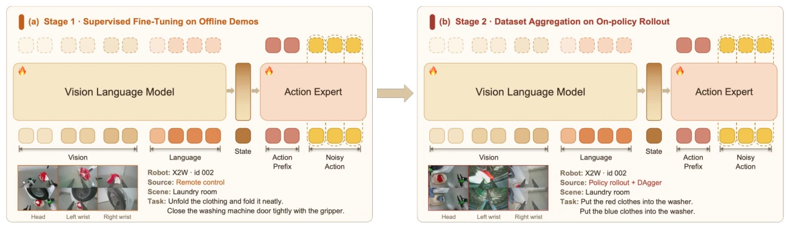

<!-- Generated by scripts/generate.py; edit data/works.json and data/media.json. -->

[← Back to the Awesome index](../../../README.md) · [Interactive website](https://chang-xinhai.github.io/Awesome-RGBDT-Manipulation/?collection=policy&item=xr2#library)

# XR-2

Scaling Bimanual Household Manipulation from 1,500 hours of Demonstrations to On-Policy Corrections

**2026-09-03 · Preprint · PrimeBot Research Institute / Peking University**

**[Paper](https://arxiv.org/abs/2609.03591)** · [Data](https://huggingface.co/datasets/challenge-2026/challenge_data)

A bimanual household VLA trains on a large demonstration corpus and improves through online human corrections.

*XR-2 authors · [Figure source](https://arxiv.org/abs/2609.03591) · Original rights retained.*

| Field | Reported value and source scope |
| :-- | :-- |
| Record type | policy |
| Policy family | VLA [1](https://arxiv.org/abs/2609.03591)  |
| Base model and architecture | Qwen3-VL-4B-Instruct and a flow-matching action expert in a Mixture-of-Transformer policy. [1](https://arxiv.org/abs/2609.03591)  |
| Model size and component | 5B total reported parameters. [1](https://arxiv.org/abs/2609.03591)  |
| Deployment inputs | Synchronized multi-view RGB observations, robot joint/state measurements and language instruction. [1](https://arxiv.org/abs/2609.03591)  |
| Action outputs and horizon | 50×25 whole-body joint action chunk, temporally ensembled for execution. [1](https://arxiv.org/abs/2609.03591)  |
| Training method | Multi-stage flow-matching pretraining followed by streamed human-intervention DAgger corrections. [1](https://arxiv.org/abs/2609.03591)  |
| Training data | 1,500 hours of bimanual household demonstrations; DAgger interventions provide additional corrective data. [1](https://arxiv.org/abs/2609.03591)  |
| Training duration | Each DAgger round uses 2.5 post-training epochs; full pretraining wall-clock duration not reported. [1](https://arxiv.org/abs/2609.03591)  |
| Training hardware | Not reported [1](https://arxiv.org/abs/2609.03591)  |
| Inference and control rates | RTX 4090 asynchronous policy inference at 10 Hz; joint commands at 30 Hz; whole-body controller at 1,000 Hz. [1](https://arxiv.org/abs/2609.03591)  |
| Evaluation scope | Real bimanual household tasks and data/correction scaling experiments. [1](https://arxiv.org/abs/2609.03591)  |
| Observations / modalities | RGB · Proprioception · Language |
| Evaluation domain | Real world |
| Embodiment | Bimanual |
| Release: code | Not verified |
| Release: weights | Not verified |
| Release: data | Available |
| Release: license | Not verified |
| Release: notes | The paper explicitly releases the 1,500-hour demonstration corpus. Dataset release alone does not establish XR-2 policy weights. |

**Scope and qualifications**

- The 1,500-hour quantity is data duration, not training compute.
- Policy, command and whole-body servo rates are distinct.

**Primary evidence**

1. [Original paper / author report](https://arxiv.org/abs/2609.03591) — Original full paper and supplementary experimental / implementation details; deployment inputs are separated from supervision and benchmark state.
