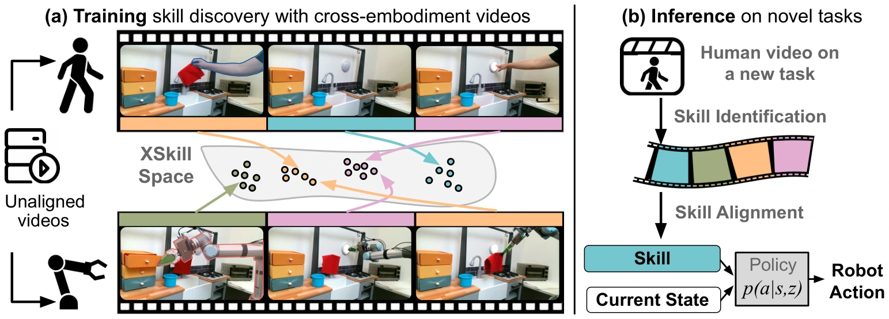

<!-- Generated by scripts/generate.py; edit data/works.json and data/media.json. -->

[← Back to the Awesome index](../../../README.md) · [Interactive website](https://chang-xinhai.github.io/Awesome-RGBDT-Manipulation/?collection=policy&item=xskill#library)

# XSkill

XSkill: Cross Embodiment Skill Discovery

**2023-07-19 · CoRL 2023 · Columbia University; J.P. Morgan AI Research; Carnegie Mellon University**

**[Paper](https://arxiv.org/abs/2307.09955)** · [Project](https://xskill.cs.columbia.edu/) · [Code](https://github.com/real-stanford/xskill) · [Data](https://xskill.cs.columbia.edu/data/real_kitchen_data.zip)

Discovers shared human–robot skill prototypes from videos, learns a skill-conditioned diffusion controller and composes skills from a new human prompt video.

*XSkill authors · [Figure source](https://arxiv.org/abs/2307.09955) · Original rights retained.*

| Field | Reported value and source scope |
| :-- | :-- |
| Record type | policy |
| Policy family | Diffusion [1](https://arxiv.org/abs/2307.09955)  |
| Base model and architecture | Cross-embodiment skill-prototype learner and skill-conditioned Diffusion Policy. [1](https://arxiv.org/abs/2307.09955)  |
| Model size and component | Not reported [1](https://arxiv.org/abs/2307.09955)  |
| Deployment inputs | Human prompt video, current robot RGB / proprioception and inferred skill prototypes. [1](https://arxiv.org/abs/2307.09955)  |
| Action outputs and horizon | Continuous robot actions conditioned on the current skill; alignment selects skills from the demonstrated sequence. [1](https://arxiv.org/abs/2307.09955)  |
| Training method | Offline cross-embodiment skill discovery and robot-policy learning; test-time human video supplies a skill composition without target-task policy fine-tuning. [1](https://arxiv.org/abs/2307.09955)  |
| Training data | Real-world training uses 175 human videos and 175 robot teleoperation demonstrations; skill discovery uses unsegmented videos and robot action supervision trains the policy. Simulation uses a separate kitchen dataset. [1](https://arxiv.org/abs/2307.09955)  |
| Training duration | Not reported [1](https://arxiv.org/abs/2307.09955)  |
| Training hardware | Not reported [1](https://arxiv.org/abs/2307.09955)  |
| Inference and control rates | Not reported [1](https://arxiv.org/abs/2307.09955)  |
| Evaluation scope | Simulated and real manipulation, including unseen skill compositions and cross-embodiment transfer. [1](https://arxiv.org/abs/2307.09955)  |
| Observations / modalities | RGB · Proprioception |
| Evaluation domain | Simulation · Real world |
| Embodiment | Parallel-jaw gripper |
| Release: code | Available [2](https://raw.githubusercontent.com/real-stanford/xskill/main/README.md)  |
| Release: weights | Not verified |
| Release: data | Available [4](https://raw.githubusercontent.com/real-stanford/xskill/main/README.md)  |
| Release: license | MIT (code); model, dependency and dataset terms are separate. [3](https://raw.githubusercontent.com/real-stanford/xskill/main/LICENSE)  |
| Release: notes | Public author repository includes implementation / execution instructions; this does not certify every physical setup or experiment artifact. The README links simulation kitchen and real kitchen dataset archives; both endpoints returned HTTP 200. Dataset terms are not inferred from the code license. [2](https://raw.githubusercontent.com/real-stanford/xskill/main/README.md)  |

**Scope and qualifications**

- This includes a trained robot-action policy, so it is more than a representation-only method.
- Skill discovery and robot-action learning use different supervision; unlabeled videos alone do not train the motor policy.

**Primary evidence**

1. [Original primary paper and appendix](https://arxiv.org/abs/2307.09955) — Survey citation is used only for discovery. Method and deployment facts come from the original paper; the date is its first submission where available. Affiliations are transcribed from the PDF author block / footnotes; LMPC affiliation is confirmed by its official project page.
2. [Author repository README](https://raw.githubusercontent.com/real-stanford/xskill/main/README.md) — Public author repository includes implementation / execution instructions; this does not certify every physical setup or experiment artifact.
3. [Repository LICENSE](https://raw.githubusercontent.com/real-stanford/xskill/main/LICENSE) — Code-license text checked directly; this license is not automatically assigned to model weights or third-party data.
4. [XSkill data archive links](https://raw.githubusercontent.com/real-stanford/xskill/main/README.md) — Simulation kitchen.zip and real_kitchen_data.zip are directly author-hosted and reachable; archives were not downloaded in this audit.
