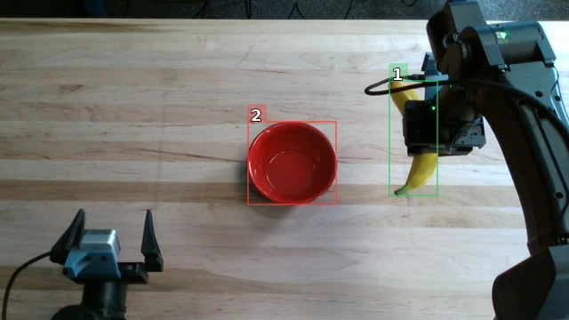

<!-- Generated by scripts/generate.py; edit data/works.json and data/media.json. -->

[← Back to the Awesome index](../../../README.md) · [Interactive website](https://chang-xinhai.github.io/Awesome-RGBDT-Manipulation/?collection=policy&item=zap#library)

# ZAP

Pretraining Knows What, Simulation Teaches How: Compositional Generalization in a Sim-Trained Robot Agent

**2026-10-26 · Preprint · Luma AI**

**[Paper](https://arxiv.org/abs/2610.35817)**

A simulation-trained tool-calling VLM agent uses measured depth and perception queries to issue robot poses, transferring from simulation to real YAM arms.

*ZAP authors · [Figure source](https://arxiv.org/html/2610.35817v1/figures/interface/yam_real.jpg) · Original rights retained.*

| Field | Reported value and source scope |
| :-- | :-- |
| Record type | policy |
| Policy family | Robot agent [1](https://arxiv.org/html/2610.35817v1)  |
| Base model and architecture | Qwen 3.6 27B plus SAM 3.1 for queried object masks [1](https://arxiv.org/html/2610.35817v1)  |
| Model size and component | 27B VLM [1](https://arxiv.org/html/2610.35817v1)  |
| Deployment inputs | Camera images and calibrated depth, object 3D readouts, robot pose and controller feedback. [1](https://arxiv.org/html/2610.35817v1)  |
| Action outputs and horizon | Tool calls for end-effector poses, gripper, perception query, task list and episode completion. [1](https://arxiv.org/html/2610.35817v1)  |
| Training method | Supervised fine-tuning on mined successful simulated rollouts followed by GRPO; policy weights are updated before deployment. [1](https://arxiv.org/html/2610.35817v1)  |
| Training data | 40 simulated pick/place, stacking and reorientation tasks; no real robot training data. [1](https://arxiv.org/html/2610.35817v1)  |
| Training duration | Not reported [1](https://arxiv.org/html/2610.35817v1)  |
| Training hardware | Not reported [1](https://arxiv.org/html/2610.35817v1)  |
| Inference and control rates | Not reported [1](https://arxiv.org/html/2610.35817v1)  |
| Evaluation scope | Real bimanual YAM: 10 tasks × 3 trials, 96.7% success; single-arm Franka RoboLab-120: 55.9% in simulation. [1](https://arxiv.org/html/2610.35817v1)  |
| Observations / modalities | RGB · Depth · Proprioception · Language |
| Evaluation domain | Simulation · Real world |
| Embodiment | Bimanual · Parallel-jaw gripper |
| Release: code | Not verified [1](https://arxiv.org/html/2610.35817v1)  |
| Release: weights | Not verified [1](https://arxiv.org/html/2610.35817v1)  |
| Release: data | Not verified [1](https://arxiv.org/html/2610.35817v1)  |
| Release: license | Not verified [1](https://arxiv.org/html/2610.35817v1)  |
| Release: notes | Paper is public; no author-linked implementation or checkpoint identified in the inspected paper. [1](https://arxiv.org/html/2610.35817v1)  |

**Scope and qualifications**

- Real-robot comparison uses only three trials per task.
- Franka RoboLab-120 evaluation is simulation, separate from the real YAM evaluation.
- Real-time SAM masks and depth geometry are components of the evaluation harness, not proof of depth-free deployment.

**Primary evidence**

1. [Original full paper](https://arxiv.org/html/2610.35817v1) — Sections 3–4 specify calibrated depth, simulation training and three real trials per task; paper links do not establish public implementation.
