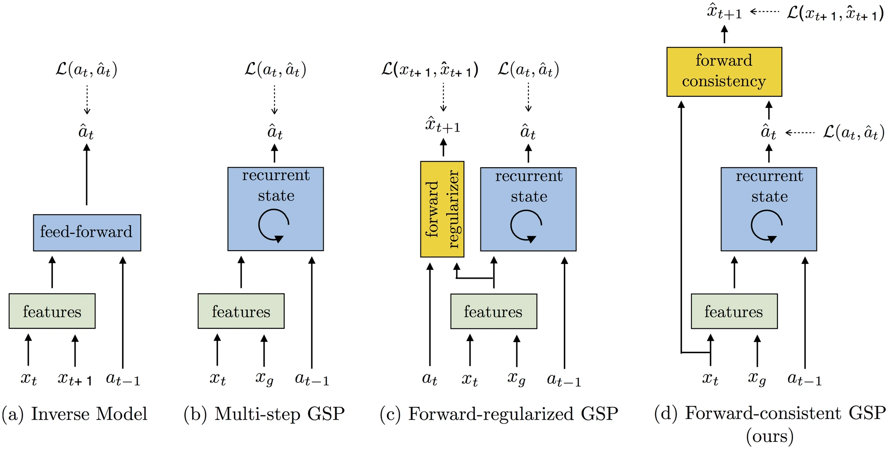

<!-- Generated by scripts/generate.py; edit data/works.json and data/media.json. -->

[← Back to the Awesome index](../../../README.md) · [Interactive website](https://chang-xinhai.github.io/Awesome-RGBDT-Manipulation/?collection=policy&item=zero-shot-visual-imitation#library)

# Zero-Shot Visual Imitation / GSP

Zero-Shot Visual Imitation

**2018-04-23 · ICLR 2018 · UC Berkeley**

**[Paper](https://arxiv.org/abs/1804.08606)** · [Project](https://pathak22.github.io/zeroshot-imitation/) · [Code](https://github.com/pathak22/zeroshot-imitation)

A goal-conditioned skill policy learns from self-supervised exploration, then imitates a sequence of visual goals without expert action labels.

*Zero-Shot Visual Imitation / GSP authors · [Figure source](https://pathak22.github.io/zeroshot-imitation/) · Original rights retained.*

| Field | Reported value and source scope |
| :-- | :-- |
| Record type | policy |
| Policy family | Goal-conditioned policy [1](https://arxiv.org/abs/1804.08606)  |
| Base model and architecture | Rope manipulation uses pretrained AlexNet features and a goal-conditioned skill network with forward-consistency training. [1](https://arxiv.org/abs/1804.08606)  |
| Model size and component | Not reported [1](https://arxiv.org/abs/1804.08606)  |
| Deployment inputs | Current RGB observation and demonstration goal-image sequence. [1](https://arxiv.org/abs/1804.08606)  |
| Action outputs and horizon | Grasp location, displacement direction and displacement magnitude for rope manipulation. [1](https://arxiv.org/abs/1804.08606)  |
| Training method | Self-supervised exploration and forward-consistent goal-conditioned skill prediction. [1](https://arxiv.org/abs/1804.08606)  |
| Training data | Approximately 60k rope interaction pairs collected through self-supervised exploration; no expert actions for demonstration imitation. [1](https://arxiv.org/abs/1804.08606)  |
| Training duration | Not reported [1](https://arxiv.org/abs/1804.08606)  |
| Training hardware | Not reported [1](https://arxiv.org/abs/1804.08606)  |
| Inference and control rates | Not reported [1](https://arxiv.org/abs/1804.08606)  |
| Evaluation scope | Real Baxter rope manipulation; separate navigation / VizDoom experiments test the broader approach. [1](https://arxiv.org/abs/1804.08606)  |
| Observations / modalities | RGB |
| Evaluation domain | Real world |
| Embodiment | Parallel-jaw gripper |
| Release: code | Available [2](https://pathak22.github.io/zeroshot-imitation/) [3](https://github.com/pathak22/zeroshot-imitation)  |
| Release: weights | Partial [2](https://pathak22.github.io/zeroshot-imitation/) [3](https://github.com/pathak22/zeroshot-imitation)  |
| Release: data | Not verified [2](https://pathak22.github.io/zeroshot-imitation/) [3](https://github.com/pathak22/zeroshot-imitation)  |
| Release: license | Not verified [2](https://pathak22.github.io/zeroshot-imitation/) [3](https://github.com/pathak22/zeroshot-imitation)  |
| Release: notes | Official project provides code/models; modalities and architectures differ between rope and navigation domains. [2](https://pathak22.github.io/zeroshot-imitation/) [3](https://github.com/pathak22/zeroshot-imitation)  |

**Scope and qualifications**

- Not excluded as navigation-only: the original paper includes a real Baxter rope-manipulation experiment.
- Navigation ResNet-50 architecture and frame counts are not substituted for the rope-policy setting.

**Primary evidence**

1. [Original paper / author report](https://arxiv.org/abs/1804.08606) — Original full paper and supplementary experimental / implementation details; deployment inputs are separated from supervision and benchmark state.
2. [Official project](https://pathak22.github.io/zeroshot-imitation/) — Author-linked project and current release checked on the catalog cutoff.
3. [Official code / release documentation](https://github.com/pathak22/zeroshot-imitation) — Current repository documentation; paper settings and subsequently released artifacts are distinguished.
